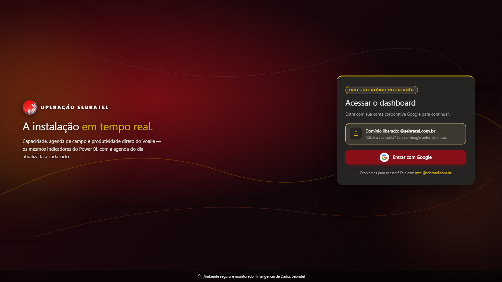
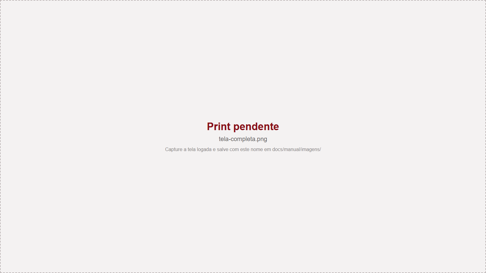

# Primeiros passos

## O que é o Dashboard de Instalação

O Dashboard de Instalação mostra, numa tela só, os números da operação de instalação: protocolos abertos e realizados, agenda do campo, premiação, manutenção inicial e reincidência. É a versão web do relatório "INST - Relatório Instalação" do Power BI, com as mesmas abas e na mesma ordem.

- **Os mesmos números** {LuDatabase}: as abas vêm do relatório do Power BI, com os mesmos filtros e as mesmas medidas.
- **Atualizado sozinho** {LuRefreshCw}: os dados são buscados do Voalle ao longo do dia, sem ninguém apertar nada.
- **Aberto no navegador** {LuMonitorPlay}: nada para instalar; o endereço funciona na rede da empresa.

## Primeiro acesso

1. Abra o endereço do dashboard no navegador.
2. Clique em "Entrar com Google" e escolha sua conta @sebratel.com.br.
3. Pronto: o painel abre na aba CAPA, com as abas liberadas para você.

> **Só conta corporativa entra.** Se aparecer "Sem acesso ao dashboard", sua conta entrou mas ainda não tem aba liberada: envie o e-mail que a tela mostra a um administrador e peça a liberação.

## Conhecendo a tela

1. Barra superior: compartilhar, tema, atualizar e sua conta
2. Faixa de abas: clique para trocar de tela
3. Barra de filtros: período e seletores da aba
4. Visuais: indicadores, gráficos e tabelas

## Como tudo se organiza

- **Aba**: cada aba é uma tela do relatório, com os seus próprios visuais e filtros.
- **Filtro**: o que você escolhe na barra vale para a aba inteira.
- **Visual**: cada cartão, gráfico ou tabela é calculado com os filtros ativos.
- **Link**: o endereço do navegador guarda a aba e os filtros — dá para compartilhar.
