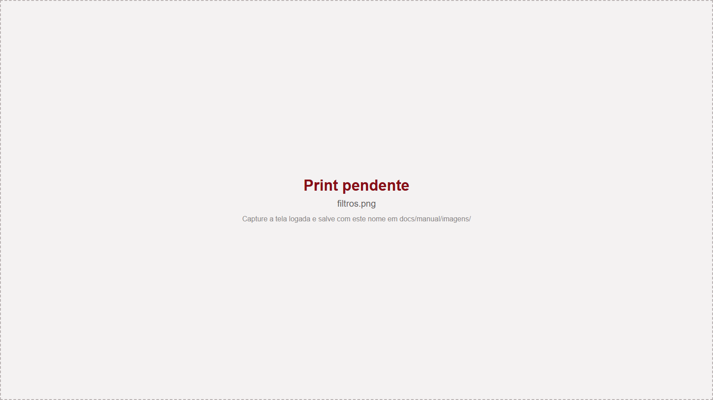

# Filtros

## Escolher o período

1. Clique no filtro de período, na barra de filtros.
2. Abra o ano, o trimestre ou o mês e marque o que quiser ver.
3. Os visuais da aba recalculam com o período escolhido.

> **O período já vem preenchido** com o padrão da aba. Para ver tudo, use o botão de limpar filtros, no fim da barra.

## Filtrar por cidade, equipe, status

- **Seletores** {LuFilter}: cada aba traz os filtros do relatório original — cidade, equipe, status, tipo de solicitação, instalador, responsável.
- **Chips** {LuCheck}: cada filtro escolhido vira um chip na barra; clique no "x" do chip para tirar só aquele.
- **Limpar tudo** {LuRefreshCw}: o botão no fim da barra remove todos os filtros da página, inclusive o período padrão.

## Clicar no gráfico também filtra

1. Clique numa barra do gráfico — por exemplo, uma cidade.
2. Os outros visuais da aba passam a mostrar só aquela cidade.
3. Clique de novo na mesma barra para desfazer.

> **O gráfico clicado continua mostrando todas as categorias**, com a escolhida destacada. É de propósito: você perderia a comparação que motivou o clique.

## Levar o que você está vendo para outra pessoa

1. Deixe a aba e os filtros do jeito que quer mostrar.
2. Clique no botão de compartilhar, na barra superior.
3. Cole o link no chat ou no e-mail: quem abrir vê o mesmo recorte.

> **O link respeita o acesso de quem abre.** Quem não tem a aba liberada continua sem ver.
