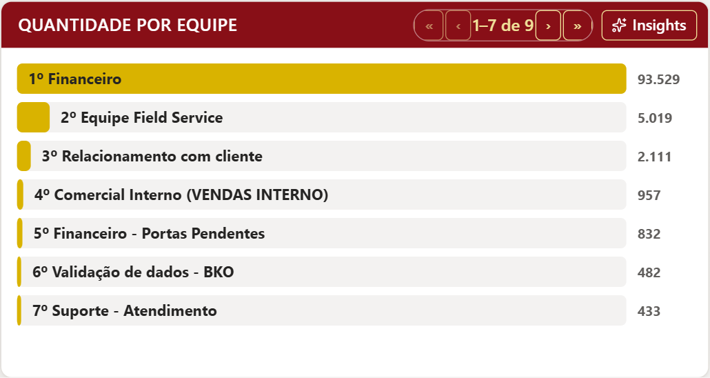

# Indicadores e gráficos

## Ler os indicadores

Cada cartão mostra um número já filtrado pelo que está na barra: trocou o período ou a cidade, o cartão recalcula. Quando o indicador tem meta, o cartão mostra a comparação com ela.

- **O número é da seleção atual** {LuFilter}: não existe cartão "fora do filtro".
- **As casas decimais são as do relatório** {LuDatabase}: cada medida traz o próprio formato.
- **A meta vem da aba METAS** {LuLightbulb}: editada pela operação, chega ao cartão no ciclo seguinte.

## Ler os gráficos

1. O valor de cada barra aparece desenhado, sem precisar passar o mouse
2. Clique numa barra para filtrar a aba por aquele item
3. O contador do cabeçalho mostra quanto você está vendo do total ("1–7 de 9")
4. As setas do cabeçalho avançam para os itens seguintes

## O gráfico não rola: ele pagina

1. Quando as categorias não cabem com largura legível, o visual mostra uma janela com paginador.
2. Clique nas setas para ver as categorias seguintes.
3. Quantas cabem por página é decidido pelo tamanho do card e pelo tamanho dos rótulos.

> **Os números aparecem desenhados sobre as barras** sempre que cabem, para que o print do gráfico seja lido no celular, sem abrir o painel.
