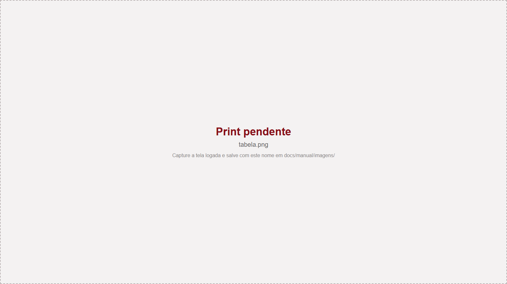

# Tabelas e exportação

## Trabalhar com a tabela

1. Clique no cabeçalho da coluna para ordenar; a seta mostra a direção.
2. Use o campo "Filtrar…" para procurar dentro do que está na tela.
3. Use a paginação do rodapé para ver as linhas seguintes.

> **O corte é sempre dito.** Quando a tabela mostra só parte das linhas, a própria tela avisa — ela nunca esconde linha em silêncio.

## Baixar em CSV

1. Clique no botão de exportar, no cabeçalho da tabela.
2. Espere a barra de progresso: o arquivo traz **todas as linhas do período filtrado**, não só a página aberta.
3. Abra o arquivo no Excel ou no Google Planilhas.

> **O arquivo pode ter dado de cliente** (nome, telefone, endereço). Compartilhe só com quem precisa, dentro da empresa.

## Pedir a leitura da IA

1. Clique no botão de IA, no cabeçalho de um gráfico, ranking ou matriz.
2. Leia o resumo e os pontos marcados como crítico, atenção ou positivo.
3. Cada ponto traz uma ação sugerida.

> **A IA lê o mesmo número que você vê**, com os filtros que estão aplicados na tela.
